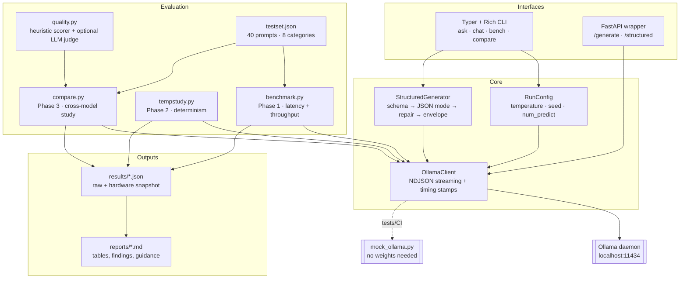

<div align="center">

# 🧠 LocalMind

**A fully offline AI assistant built on small language models — with a measurement habit.**

*No API keys. No network calls. No telemetry. Just your laptop, a 2 GB model file, and honest numbers.*

🏆 **2nd Prize, Best Mini Project**, Department of Information Technology, St. Joseph's Institute of Technology, Chennai
<br><sub>Niteesh Kumar S K · Apr–Aug 2025</sub>

[](https://github.com/NiteeshSK/localmind/actions/workflows/ci.yml)
[](https://www.python.org/)
[](https://ollama.com/)
[](https://docs.pydantic.dev/)
[](tests/)
[](#why-offline)
[](LICENSE)

[Quickstart](#-quickstart) · [The three phases](#-the-three-phases) · [Commands](#-command-reference) · [Sample report](docs/SAMPLE_REPORT.md) · [Design notes](#-design-decisions-worth-defending)

</div>

---

## What this is

Most "local LLM" projects stop at *it runs*. LocalMind is built around the harder
question: **is it good enough, how do you know, and which model should you actually ship?**

It is three things in one codebase:

| | | |
|---|---|---|
| 🖥️ **A usable assistant** | Streaming CLI chat + one-shot queries + a FastAPI wrapper | runs entirely on your machine |
| 📐 **A measurement rig** | TTFT, decode throughput, prefill throughput, cold-start cost, peak RSS — with medians, p95 and variance | because one sample is an anecdote |
| 🔬 **An evaluation study** | 40 standardised prompts × N models × quantization levels → an auto-written Markdown report | so model selection is an engineering decision, not a vibe |

### At a glance

| | |
|---|---|
| **Evaluation set** | 40 prompts across 8 categories, each with machine-checkable scoring signals |
| **Structured output** | 6 Pydantic v2 contracts; three-attempt validate-and-repair ladder that returns a typed failure envelope instead of raising |
| **Measurement** | time-to-first-token, decode and prefill throughput, cold start and peak memory, each with median, p95 and coefficient of variation |
| **Interfaces** | Typer + Rich CLI (`ask`, `chat`, `bench`, `compare` and 10 more commands) and a FastAPI service (7 endpoints) |
| **Tests** | 56 tests run against a mock Ollama daemon, so CI needs no GPU and no model weights; CI runs on Ubuntu and Windows with Python 3.10 and 3.12 |

### Why offline

| Constraint | What the cloud costs you | What LocalMind does |
|---|---|---|
| **Privacy** | Patient notes, contracts and source code leave the building | Weights and data stay on disk; the process never opens an external socket |
| **Latency** | 200–800 ms of network before the model even starts | Localhost round trip is sub-millisecond; TTFT is pure compute |
| **Cost** | Per-token billing that scales with success | Electricity |
| **Connectivity** | A rural clinic, a factory floor, a plane, a ship | Works with the Wi-Fi switched off — genuinely, try it |
| **Stability** | Your prompt breaks when the vendor silently ships a new checkpoint | The `.gguf` on your disk is the same file tomorrow |

The trade-off is real and this project measures it rather than hiding it: a 3B model
on a laptop CPU is roughly **an order of magnitude slower and noticeably less capable**
than a frontier API model. Phase 3 exists to tell you exactly how much.

---

## 🎬 What it looks like

*Illustrative terminal sessions; the numbers depend entirely on your hardware.*

```console
$ localmind ask "Explain time-to-first-token in one sentence."
llama3.2:3b · T=0.0

Time-to-first-token is the delay between sending a prompt and seeing the very
first piece of the model's reply, which is what a user actually perceives as
"how fast is it".

╭──────────── metrics ─────────────╮
│ time to first token  312 ms      │
│ decode throughput    14.82 tok/s │
│ prefill throughput   118.4 tok/s │
│ total latency        2841 ms     │
│ tokens in / out      28 / 38     │
│ peak RSS             2314 MB     │
╰──────────────────────────────────╯
```

```console
$ localmind structured "set the bedroom lamp to 40 percent" --schema command
{
  "intent": "set_value",
  "device": "bedroom lamp",
  "value": 40.0,
  "unit": "percent",
  "confidence": 0.93
}
validated against CommandIntent in 1 attempt(s) · 812 ms
```

```console
$ localmind compare -m llama3.2:3b -m phi4-mini:3.8b -m mistral:7b

comparing llama3.2:3b, phi4-mini:3.8b, mistral:7b
40 prompts × 1 repeats × 3 models = 120 generations

┏━━━━━━━━━━━━━━━━┳━━━━━━━━┳━━━━━━━━┳━━━━━━━━━┳━━━━━━━━━┳━━━━━━━┳━━━━━━━━━━┳━━━━━━━━━┓
┃ model          ┃ params ┃ quant  ┃ disk MB ┃ TTFT ms ┃ tok/s ┃ peak RSS ┃ quality ┃
┡━━━━━━━━━━━━━━━━╇━━━━━━━━╇━━━━━━━━╇━━━━━━━━━╇━━━━━━━━━╇━━━━━━━╇━━━━━━━━━━╇━━━━━━━━━┩
│ llama3.2:3b    │ …      │ …      │ …       │ …       │ …     │ …        │ …       │
└────────────────┴────────┴────────┴─────────┴─────────┴───────┴──────────┴─────────┘

✓ results → results/comparison-<timestamp>.json
✓ report  → reports/comparison-<timestamp>.md
```

> The table above is deliberately blank. **Every number in this repo must come from
> your machine.** See [`docs/SAMPLE_REPORT.md`](docs/SAMPLE_REPORT.md) for the full
> report format, generated against the mock daemon.

---

## 🏗 Architecture



Every module has one job, and the network boundary lives in exactly one file
(`client.py`) — which is why the entire test suite can run against a fake daemon
with no models installed.

---

## 🚀 Quickstart

### 1. Install the runtime

```bash
# https://ollama.com/download  (Windows / macOS / Linux)
ollama serve            # leave this running in its own terminal
```

### 2. Pull some models

```bash
ollama pull llama3.2:3b        # ~2.0 GB  — the everyday default
ollama pull phi4-mini:3.8b     # ~2.5 GB  — strong at reasoning for its size
ollama pull mistral:7b         # ~4.4 GB  — the quality ceiling on 16 GB CPU
```

> **A note on Phi-4.** Full `phi4` is a **14 B** model (~9 GB at Q4). It will load on a
> 16 GB laptop and then produce ~2 tok/s, which is unusable interactively. Use
> **`phi4-mini:3.8b`** for this project unless you have a discrete GPU. LocalMind's
> `doctor` command will warn you about this.

### 3. Install LocalMind

```bash
git clone https://github.com/NiteeshSK/localmind.git
cd localmind
python -m venv .venv && source .venv/bin/activate   # Windows: .venv\Scripts\activate
pip install -e ".[api,dev]"
```

### 4. Check everything

```bash
localmind doctor
```

```console
 os                Windows 11
 processor         Intel64 Family 6 — i7-1360P
 physical cores    12 / 16 logical
 ram total gb      15.7
 gpus              none detected

Ollama at http://localhost:11434: reachable (v0.x.x)
╭─ sizing note ────────────────────────────────────────────────────╮
│ CPU-only inference on ≤16 GB RAM. Practical ceiling is a 7B      │
│ model at Q4 (~4.5 GB resident)…                                  │
╰──────────────────────────────────────────────────────────────────╯
```

### 5. Talk to it

```bash
localmind chat
localmind ask "Summarise the CAP theorem in three bullets."
```

### 6. Run the whole study

```bash
make study     # Phase 1 → Phase 2 → Phase 3, reports land in ./reports
```

### No models? No problem.

Every code path is exercised by a fake daemon, so you can explore the harness
before downloading gigabytes:

```bash
python tools/mock_ollama.py --port 11500          # terminal 1
localmind bench -m mock-fast:1b --host http://127.0.0.1:11500   # terminal 2
```

---

## 🔬 The three phases

### Phase 1 — Fundamentals and Measurement

> *Run a 3–7 B open model locally, wrap it in a CLI, and measure it properly.*

```bash
localmind bench -m llama3.2:3b --repeats 3
localmind bench -m mistral:7b --category code --category reasoning --repeats 5
```

**What gets measured**

| Metric | Definition | Why it matters |
|---|---|---|
| **Time to first token (TTFT)** | Wall clock from request send → first visible token | This *is* perceived speed. A model with great throughput and 3 s TTFT feels broken. |
| **Decode throughput** | `eval_count ÷ eval_duration` | How fast text streams once it starts. Above ~6 tok/s it outpaces reading speed. |
| **Prefill throughput** | `prompt_eval_count ÷ prompt_eval_duration` | Dominates long-context and RAG workloads; invisible on short prompts. |
| **Total latency** | Full request→last token, client-side | The number you put in an SLA. |
| **Cold start** | Model evicted (`keep_alive: 0`), then timed | On a laptop this is often the single largest term, and it is usually left out of benchmarks. |
| **Peak RSS** | Sampled 4×/second in a background thread | The constraint that actually decides what you can run. |

**Three measurement decisions that matter more than the code**

1. **Warm-up runs are discarded.** The first call after load pays the weight-load tax and a cold page cache. Averaging it in hides steady-state performance.
2. **Cold start is measured separately, on purpose.** It is a real cost, so it gets its own row rather than polluting the mean.
3. **Nothing is reported as a single number.** Every metric ships with median, mean, p95, min, max and a coefficient of variation. If CV > 0.15, the report says so and tells you not to quote the mean.

Output: `results/benchmark-<model>-<ts>.json` + a rendered `reports/*.md`.

---

### Phase 2 — Structure and Determinism

> *Make an inherently stochastic system behave like an API.*

```bash
localmind schemas                                              # list contracts
localmind structured "Extract entities: Priya Raman of Infosys met Daniel Cho in Bengaluru on 12 March 2024." -s entities
localmind structured "Plan a 3-step backup routine" -s plan --show-attempts
localmind temp-study --temps 0,0.3,0.7,1.0 --samples 10 -s command
```

#### The retry ladder

A 3 B model produces valid JSON *usually*. Pydantic turns "usually" into a
hard boundary, and the pipeline escalates instead of giving up:

```
attempt 1 ─ native structured output   Ollama `format: <json-schema>`   ← strongest guarantee
attempt 2 ─ JSON mode                  `format: "json"` + schema in the system prompt
attempt 3 ─ repair prompt              show it the bad output + the exact validator errors,
                                       temperature forced to 0.0
exhausted ─ FailureEnvelope            {"ok": false, "error": …, "last_raw": …}
```

Two details that earn their keep:

- **Repairs run at temperature 0.** If the first sample was malformed, more randomness is not the fix.
- **The pipeline never raises into the caller.** A failed generation returns a typed envelope, so a downstream service degrades instead of 500-ing. The CLI exits `2`; the API returns `422`.

The JSON extractor is string-aware brace matching, not a regex — it survives
chatty preambles, markdown fences, `}` characters inside string values, and
trailing commas. All nine of those cases are pinned by tests.

#### Built-in schemas

| Name | Shape | Use case |
|---|---|---|
| `answer` | answer, key_points, confidence, needs_more_info | general Q&A |
| `summary` | title, summary, 2–6 bullets, topics | document processing |
| `classification` | label (enum), confidence, rationale | sentiment / triage |
| `entities` | people, organizations, locations, dates, amounts | information extraction |
| `plan` | goal, ordered steps, estimated_minutes | agent-style task decomposition |
| `command` | intent (enum), device, value, unit, confidence | offline voice control on edge devices |

#### The temperature study

`localmind temp-study` runs the same prompt N times at each temperature and turns
"temperature controls randomness" into numbers you can defend:

| Column | What it captures |
|---|---|
| `unique / N` + `dup rate` | how often two samples were byte-identical |
| `mean pairwise Jaccard` | word-set overlap across **every pair** of samples (1.000 = identical vocabulary) |
| `length CV` | how much the output length wanders |
| `schema valid rate` | **does randomness break structure?** — the column that decides what is safe in production |
| `answer stability` | does the *extracted value* change, or only the wording? |

That last distinction is the point. Temperature 0.7 that rephrases is harmless.
Temperature 0.7 that changes the extracted `value` from `40` to `45` is a bug
that ships. Add `--fixed-seed` to demonstrate the other half of the story:
with a pinned seed, even T=0.7 becomes reproducible.

---

### Phase 3 — Model Comparison Study

> *Choose a model like an engineer, not like a follower of trends.*

```bash
# three architectures, same machine, same prompts
localmind compare -m llama3.2:3b -m phi4-mini:3.8b -m mistral:7b

# quantization ladder: what does Q4 actually cost you versus Q8?
ollama pull llama3.2:3b-instruct-q4_K_M
ollama pull llama3.2:3b-instruct-q5_K_M
ollama pull llama3.2:3b-instruct-q8_0
localmind compare --preset quant

# add a second opinion from a local judge model
localmind compare --judge mistral:7b
```

#### The test set

40 prompts, 8 categories, versioned in [`localmind/data/testset.json`](localmind/data/testset.json):

| Category | n | Probes |
|---|---|---|
| factual | 6 | recall without hallucination |
| reasoning | 6 | multi-step logic, transitivity, time arithmetic |
| math | 4 | arithmetic the model must not fumble |
| code | 6 | generation, bug-spotting, shell, SQL |
| extraction | 6 | JSON-shaped output under a schema |
| summarization | 4 | compression with a length budget |
| instruction | 5 | exact compliance (word caps, banned words, "one word only") |
| creative | 3 | open-ended generation |

Every prompt carries its own scoring signal — `expected_keywords`, and machine-checkable
`checks` such as `max_words`, `min_bullets`, `must_be_json`, `must_not_contain`.

#### How quality is scored

Two **independent** scorers, never silently blended:

**1. `HeuristicScorer`** — deterministic, free, reproducible:

```
composite = 45% keyword coverage
          + 40% instruction compliance      (word caps, bullets, JSON validity, banned words)
          + 15% non-degeneracy              (unique-trigram ratio; catches repetition loops)

  × 0.5 penalty for boilerplate refusals
  → 0    for empty output
```
Weights renormalise when a signal is absent, so a prompt with no keyword list is
not silently penalised.

**2. `LLMJudge`** *(opt-in, `--judge <model>`)* — a second local model grades
relevance / accuracy / clarity 1–5 and returns JSON. Reported in its **own column**,
because a small model judging a small model is a weak signal and averaging it into
the composite would launder that weakness.

#### Fairness rules the harness enforces

- Identical prompts, decoding params, machine and session for every model
- Each model gets its **own discarded warm-up** and its **own cold-start measurement**
- Models are **unloaded between runs** so one model's residency never inflates another's memory reading
- The **same** deterministic scorer grades everyone
- Every result file embeds a hardware snapshot, so a table can never be quoted out of context

#### What the report concludes for you

The generated report does not stop at tables. It auto-writes findings —
`"X decodes 2.34× faster than Y"`, `"quality spread is 6.1 points"`,
`"no single winner: X is fastest, Y scores highest"` — plus a **selection guidance**
section that maps workloads to models:

| Workload | Chosen by |
|---|---|
| Interactive chat / voice front-end | lowest TTFT — perceived latency dominates |
| Batch extraction, offline documents | highest quality — nobody is watching the stream |
| Running beside an IDE, browser, containers | smallest peak RSS — headroom beats score |
| One model to deploy | best **quality per second of wait** |

…and a **threats to validity** section, because a benchmark that does not list its
own weaknesses is marketing.

---

## 📋 Command reference

| Command | Phase | What it does |
|---|---|---|
| `localmind doctor` | — | Hardware snapshot, daemon check, installed models, sizing warnings |
| `localmind models` | — | Installed models + what is resident in memory right now |
| `localmind pull <model>` | — | Download a model with live progress |
| `localmind ask "…"` | 1 | One-shot streaming answer + metrics panel (`--json` for machine use) |
| `localmind chat` | 1 | Interactive REPL — `/reset` `/model` `/temp` `/stats` `/save` |
| `localmind bench` | 1 | Full latency/throughput/memory benchmark + report |
| `localmind schemas` | 2 | List the Pydantic output contracts |
| `localmind structured "…" -s plan` | 2 | Schema-enforced JSON with the retry ladder |
| `localmind temp-study` | 2 | Temperature → variance and schema-validity sweep |
| `localmind compare` | 3 | Cross-model / cross-quantization study |
| `localmind report [file]` | 3 | Re-render any saved result as Markdown |
| `localmind testset --show` | 3 | Inspect the evaluation prompts |
| `localmind serve` | — | FastAPI wrapper, OpenAPI docs at `/docs` |

Useful flags: `--host` (point at any daemon, including the mock), `--limit` / `--category`
(shorten a run while iterating), `--repeats`, `--seed`, `--temperature`,
`--no-report`, `--show-attempts`.

---

## 🌐 HTTP API

```bash
localmind serve            # http://127.0.0.1:8000/docs
```

| Endpoint | Purpose |
|---|---|
| `GET /health` | daemon + version check |
| `GET /hardware` | machine fingerprint |
| `GET /models` | installed and resident models |
| `GET /schemas` | JSON Schema for every contract |
| `POST /generate` | text in, text + full metrics out |
| `POST /generate/stream` | token stream; final event carries the metrics |
| `POST /structured` | validated object, or `422` with the failure envelope |

```bash
curl -s localhost:8000/structured -H 'content-type: application/json' -d '{
  "prompt": "turn off the garage light",
  "schema_name": "command",
  "model": "llama3.2:3b"
}' | jq
```

Binds to `127.0.0.1` by default. Nothing leaves the machine.

---

## 🧪 Testing

```bash
pytest -q          # 56 tests, ~50 s, zero models required
```

The whole suite — streaming, timing counters, native schema mode, the retry
ladder, the benchmark harness, the comparison harness, report rendering — runs
against [`tools/mock_ollama.py`](tools/mock_ollama.py), a fake daemon that
implements enough of the Ollama API to be indistinguishable to the client and
**synthesises a valid instance directly from whatever JSON Schema you send it**.

That is why CI runs on Ubuntu *and* Windows with Python 3.10 and 3.12 without a
GPU, without weights, and without network access beyond PyPI.

Tests worth reading:

- `test_structured.py` — nine JSON-extraction edge cases small models actually produce
- `test_quality.py` — proves the scorer is bounded, penalises loops, and catches refusals
- `test_integration.py::test_retry_ladder_gives_up_gracefully` — asserts the pipeline *never* raises
- `test_integration.py::test_repair_attempt_forces_temperature_zero` — pins the determinism rule
- `test_quality.py::TestTestSet` — enforces the 30–50 prompt requirement and that every prompt is scoreable

---

## 📁 Project structure

```
localmind/
├── localmind/
│   ├── cli.py            # Typer + Rich command line — every phase is one command
│   ├── client.py         # the ONLY file that touches the network; streaming + timing
│   ├── config.py         # RunConfig, defaults, env overrides
│   ├── schemas.py        # Phase 2 — six Pydantic output contracts
│   ├── structured.py     # Phase 2 — retry ladder, JSON extraction, failure envelope
│   ├── benchmark.py      # Phase 1 — warm-up, cold start, repeated sampling
│   ├── tempstudy.py      # Phase 2 — determinism sweep and variance math
│   ├── compare.py        # Phase 3 — fair cross-model evaluation + auto findings
│   ├── quality.py        # Phase 3 — heuristic scorer + optional LLM judge
│   ├── metrics.py        # percentiles, CV, aggregation, result persistence
│   ├── report.py         # JSON → Markdown technical reports
│   ├── sysinfo.py        # hardware fingerprint + background RSS sampler
│   ├── testset.py        # test-set loader and filters
│   └── data/testset.json # 40 prompts × 8 categories
├── api/server.py         # FastAPI wrapper
├── tools/mock_ollama.py  # fake daemon — tests and demos with zero models
├── tests/                # 56 tests, unit + end-to-end
├── docs/SAMPLE_REPORT.md # what a generated report looks like
├── results/  reports/    # generated artefacts (git-ignored)
└── Makefile              # make bench / temp / compare / study
```

---

## 🧭 Design decisions worth defending

**Raw HTTP instead of the `ollama` Python package.**
Phase 1 is about measurement. Streaming the NDJSON ourselves lets us stamp the wall
clock at the exact moment the first token lands, then reconcile that against the
server's nanosecond counters. A convenience wrapper would hide the one number the
project exists to capture.

**Client-side *and* server-side timing.**
TTFT is measured client-side because that is what a user feels. Throughput uses
Ollama's `eval_count / eval_duration` because that excludes HTTP overhead. Reporting
only one of them is how benchmarks end up wrong.

**The network boundary lives in exactly one file.**
`client.py` is the only module that touches a socket, which is what makes the mock
daemon possible and the test suite fast.

**Quality scoring is explicit and auditable.**
Weights are constants in `quality.py`, every sub-score is stored per prompt, and the
report states the formula. "Quality: 71" means nothing unless you can see how it was
computed — so you can.

**The report states its own threats to validity.**
Heuristic scoring is not human grading. RSS understates GPU footprints. Laptop
thermal throttling moves numbers between a cold and a hot chassis. All three are
printed in the generated report rather than left for a reviewer to find.

**Failure is a return value, not an exception.**
`StructuredResult.envelope()` always returns something a caller can branch on. Edge
deployments fail at 3 a.m. with nobody watching; a typed failure beats a traceback.

---

## 🗺 Roadmap

- [ ] RAG over a local document folder (embeddings via `nomic-embed-text`, all offline)
- [ ] Tool calling with the same schema-enforcement discipline
- [ ] Energy measurement (joules per 1 000 tokens) — the metric that matters on battery
- [ ] Speculative decoding: 1 B draft + 7 B verifier on CPU
- [ ] Human-rating mode to calibrate the heuristic scorer against real judgement
- [ ] Prompt-cache reuse measurement for multi-turn chat

---

## 🙏 Acknowledgements

Built on [Ollama](https://ollama.com/), [Pydantic](https://docs.pydantic.dev/),
[Typer](https://typer.tiangolo.com/) and [Rich](https://rich.readthedocs.io/).
Model families referenced: Meta Llama 3.2, Microsoft Phi-4-mini, Mistral 7B.

## 📄 License

MIT — see [LICENSE](LICENSE).

<div align="center">

**If a benchmark has no error bars and no hardware listed, it is a screenshot, not a measurement.**

</div>
